# Лабораторная работа 3

## Часть 1

## 1 Выборка из одной таблицы

### 1.1 Сортировка по двум признакам

**Вопрос:** Как вывести ФИО, дату рождения, пол и образование всех соискателей, отсортировав их по дате рождения по убыванию, а при одинаковой дате рождения — по ФИО по возрастанию?

**Ожидаемый результат:**

| ФИО | Дата рождения | Пол | Образование |
| --- | --- | --- | --- |
| Svetlana Ivanova | 1998-01-30 | Женский | Высшее |
| Olga Fedorova | 1996-06-17 | Женский | Среднее специальное |
| Alexey Smirnov | 1995-04-12 | Мужской | Высшее |
| Pavel Kuznetsov | 1994-11-05 | Мужской | Высшее |
| Marina Belova | 1992-08-21 | Женский | Высшее |

**SQL-запрос**

```sql
SELECT full_name, birth_date, sex, education
FROM headhunter.unemployed
ORDER BY birth_date DESC, full_name ASC;
```

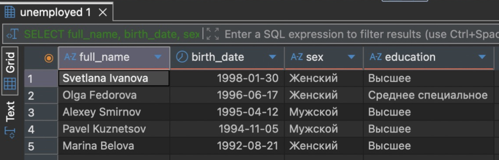

### 1.2.1 Отбор по статусу и зарплате

**Вопрос:** Какие вакансии активны и имеют нижнюю границу зарплаты не менее 150 000 рублей? Вывести идентификатор вакансии, границы зарплаты и статус.

**Ожидаемый результат:**

| ID вакансии | Зарплата от, ₽ | Зарплата до, ₽ | Статус |
| ---: | ---: | ---: | --- |
| 1 | 180 000 | 250 000 | Активна |
| 4 | 160 000 | 220 000 | Активна |

**SQL-запрос**

```sql
SELECT id,salary_from, salary_to, status
FROM headhunter.vacancy
WHERE status='Активна' AND salary_from >=150000;
```

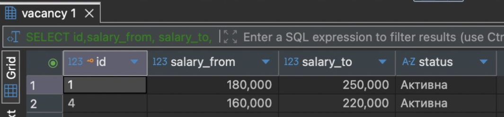

### 1.2.2 Отбор по образованию и дате рождения

**Вопрос:** Какие соискатели имеют высшее образование и родились не раньше 1 января 1995 года? Вывести ФИО, дату рождения и образование.

**Ожидаемый результат:**

| ФИО | Дата рождения | Образование |
| --- | --- | --- |
| Alexey Smirnov | 1995-04-12 | Высшее |
| Svetlana Ivanova | 1998-01-30 | Высшее |

**SQL-запрос**

```sql
SELECT full_name, birth_date, education
FROM headhunter.unemployed
WHERE education='Высшее' AND birth_date >= DATE '1995-01-01';
```

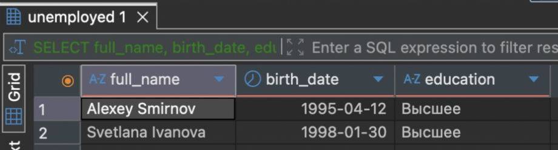

### 1.2.3 Отбор по наличию даты увольнения

**Вопрос:** В каких записях истории трудоустройств заполнена дата увольнения? Вывести идентификатор записи, дату приема, дату увольнения и причину увольнения.

**Ожидаемый результат:**

| ID трудоустройства | Дата приема (МСК) | Дата увольнения (МСК) | Причина увольнения |
| ---: | --- | --- | --- |
| 5 | 2026-09-14 09:00 | 2026-09-20 09:00 | Contract completed |

**SQL-запрос**

```sql
SELECT id, created_at, dismissal_at, dismissal_reason
FROM headhunter.employment
WHERE dismissal_at IS NOT NULL;
```

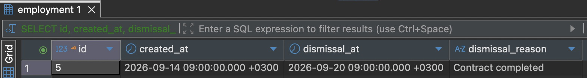

### 1.3.1 Агрегатная функция без группировки

**Вопрос:** Сколько всего соискателей зарегистрировано в таблице `unemployed`?

**Ожидаемый результат:**

| Соискателей |
| ---: |
| 5 |

**SQL-запрос**

```sql
SELECT COUNT(id) AS total_count
FROM headhunter.unemployed;
```

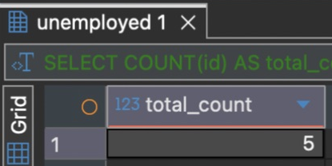

### 1.3.2 Несколько агрегатных функций без группировки

**Вопрос:** Каковы минимальное, максимальное и среднее значения нижней границы зарплаты, а также сумма нижних границ зарплаты по всем вакансиям?

**Ожидаемый результат:**

| Минимум, ₽ | Максимум, ₽ | Среднее, ₽ | Сумма, ₽ |
| ---: | ---: | ---: | ---: |
| 90 000 | 180 000 | 130 000 | 650 000 |

**SQL-запрос**

```sql
SELECT MIN(salary_from) AS min_salary, MAX(salary_from) AS max_salary, AVG(salary_from) AS avg_salary, SUM(salary_from) AS sum_salary
FROM headhunter.vacancy;
```

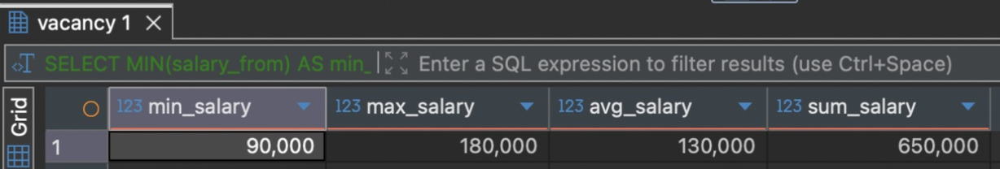

### 1.3.3 Агрегатная функция с группировкой

**Вопрос:** Сколько соискателей каждого пола зарегистрировано в базе?

**Ожидаемый результат:**

| Пол | Соискателей |
| --- | ---: |
| Мужской | 2 |
| Женский | 3 |

**SQL-запрос**

```sql
SELECT sex, COUNT(id) AS total_count
FROM headhunter.unemployed
GROUP BY sex;
```

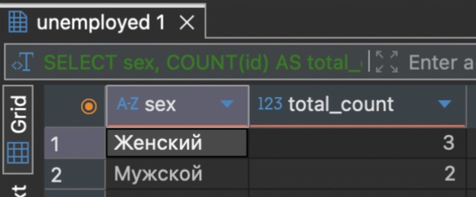

### 1.4.1 Подытоги с ROLLUP

**Вопрос:** Как посчитать количество вакансий по сочетанию минимального образования и статуса, затем получить подытог по каждому уровню образования и общий итог с помощью ROLLUP по двум столбцам?

**Ожидаемый результат:**

| Требуемое образование | Статус | Вакансий |
| --- | --- | ---: |
| Высшее | Активна | 4 |
| Высшее | `NULL` | 4 |
| Среднее специальное | Завершена | 1 |
| Среднее специальное | `NULL` | 1 |
| `NULL` | `NULL` | 5 |

`NULL` в столбце статуса обозначает подытог по образованию. Два `NULL` в последней строке обозначают общий итог.

**SQL-запрос**

```sql
SELECT education_min, status, COUNT(id) AS vacancy_count
FROM headhunter.vacancy
GROUP BY ROLLUP(education_min, status);
```

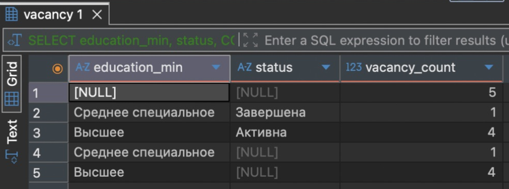

### 1.4.2 Подытоги с CUBE

**Вопрос:** Как посчитать количество соискателей по сочетанию пола и образования, получить отдельные итоги по полу, отдельные итоги по образованию и общий итог с помощью CUBE по двум столбцам?

**Ожидаемый результат:**

| Пол | Образование | Соискателей |
| --- | --- | ---: |
| Мужской | Высшее | 2 |
| Женский | Высшее | 2 |
| Женский | Среднее специальное | 1 |
| Мужской | `NULL` | 2 |
| Женский | `NULL` | 3 |
| `NULL` | Высшее | 4 |
| `NULL` | Среднее специальное | 1 |
| `NULL` | `NULL` | 5 |

`NULL` в строках подытогов означает, что подсчет выполнен по всем значениям этого столбца.

**SQL-запрос**

```sql
SELECT sex, education, COUNT(*) AS applicant_count
FROM headhunter.unemployed
GROUP BY CUBE(sex, education);
```

**Результат выполнения.** DBeaver вернул **8 строк**. Все значения совпадают с ожидаемой таблицей.

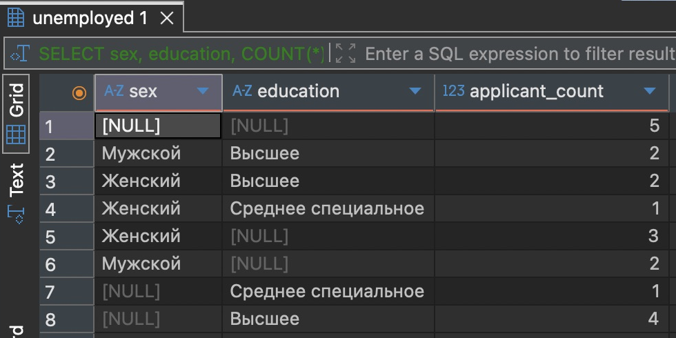

### 1.4.3 Сохранение групп с GROUP BY ALL

**Вопрос:** Какова сумма нижних границ зарплаты по активным вакансиям для каждого уровня образования? Вывести и те уровни, для которых нет активных вакансий.

**Ожидаемый результат:**

| Требуемое образование | Сумма нижних границ зарплаты, ₽ |
| --- | ---: |
| Среднее специальное | `NULL` |
| Высшее | 560 000 |


**SQL-запрос**

```sql
SELECT education_min,
       SUM(salary_from) FILTER (WHERE status = 'Активна') AS total_min_salary
FROM headhunter.vacancy
GROUP BY ALL education_min
ORDER BY education_min;
```

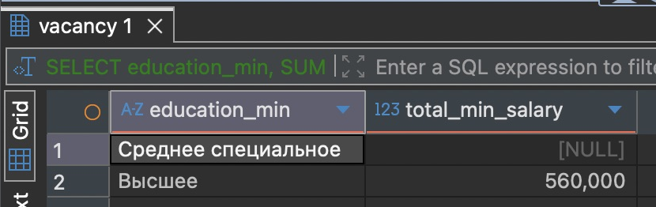

### 1.5 Отбор названий с NOT LIKE

**Вопрос:** Какие предприятия не содержат последовательность букв `Market` в названии? Вывести название, адрес и телефон предприятия.

**Ожидаемый результат:**

| Предприятие | Адрес | Телефон |
| --- | --- | --- |
| Northwind Systems | Moscow, Tverskaya 12 | +74951234501 |
| Vector Logistics | Moscow, Lenina 45 | +74951234502 |
| Bright Studio | Moscow, Arbat 18 | +74951234503 |
| Data Forge | Moscow, Mira 73 | +74951234504 |

**SQL-запрос**

```sql
SELECT title, address, phone_number
FROM headhunter.company
WHERE title NOT LIKE '%Market%';
```

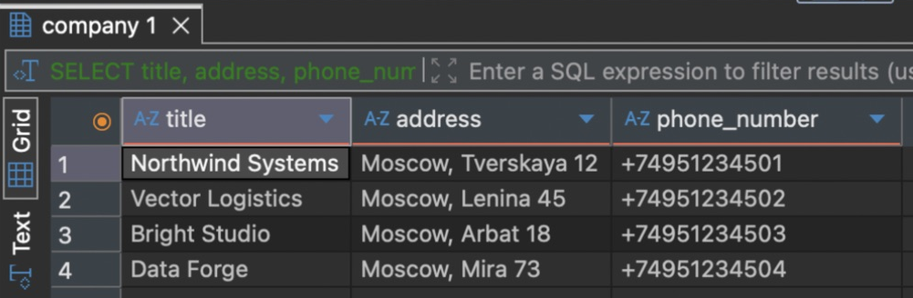

## 2 Выборка из нескольких таблиц

### 2.1.1 Соединение через WHERE для вакансий

**Вопрос:** Как вывести вакансии с названием предприятия, названием должности, границами зарплаты и статусом вместо кодов предприятия и должности, связав таблицы условием в WHERE?

**Ожидаемый результат:**

| Предприятие | Должность | Зарплата от, ₽ | Зарплата до, ₽ | Статус |
| --- | --- | ---: | ---: | --- |
| Northwind Systems | Backend Developer | 180 000 | 250 000 | Активна |
| Vector Logistics | Logistics Manager | 120 000 | 170 000 | Активна |
| Bright Studio | Graphic Designer | 100 000 | 150 000 | Активна |
| Data Forge | Data Analyst | 160 000 | 220 000 | Активна |
| Green Market | Sales Manager | 90 000 | 140 000 | Завершена |

**SQL-запрос**

```sql
SELECT
    c.title AS company_title,
    p.title AS position_title,
    v.salary_from,
    v.salary_to,
    v.status
FROM headhunter.vacancy AS v,
     headhunter.company AS c,
     headhunter.position AS p
WHERE v.company_id = c.id
  AND v.position_id = p.id;
```


### 2.1.2 Соединение через WHERE для соискателей

**Вопрос:** Как вывести ФИО, пол, образование и название желаемой должности каждого соискателя вместо кода должности, связав таблицы условием в WHERE?

**Ожидаемый результат:**

| ФИО | Пол | Образование | Желаемая должность |
| --- | --- | --- | --- |
| Alexey Smirnov | Мужской | Высшее | Backend Developer |
| Marina Belova | Женский | Высшее | Logistics Manager |
| Svetlana Ivanova | Женский | Высшее | Graphic Designer |
| Pavel Kuznetsov | Мужской | Высшее | Data Analyst |
| Olga Fedorova | Женский | Среднее специальное | Sales Manager |

**SQL-запрос**

```sql
SELECT
     un.full_name,
     un.sex,
     un.education,
     p.title AS position_title
FROM headhunter.unemployed AS un,
     headhunter.position AS p
WHERE un.position_id = p.id;
```


### 2.2.1 Внутреннее соединение для вакансий

**Вопрос:** Как получить список вакансий из задания 2.1.1 с помощью INNER JOIN?

**Ожидаемый результат:**

| Предприятие | Должность | Зарплата от, ₽ | Зарплата до, ₽ | Статус |
| --- | --- | ---: | ---: | --- |
| Northwind Systems | Backend Developer | 180 000 | 250 000 | Активна |
| Vector Logistics | Logistics Manager | 120 000 | 170 000 | Активна |
| Bright Studio | Graphic Designer | 100 000 | 150 000 | Активна |
| Data Forge | Data Analyst | 160 000 | 220 000 | Активна |
| Green Market | Sales Manager | 90 000 | 140 000 | Завершена |

**SQL-запрос**

```sql
SELECT
     c.title AS company_title,
     p.title AS position_title,
     v.salary_from,
     v.salary_to,
     v.status
FROM headhunter.position AS p
INNER JOIN headhunter.vacancy AS v ON p.id = v.position_id
INNER JOIN headhunter.company AS c ON v.company_id = c.id;
```

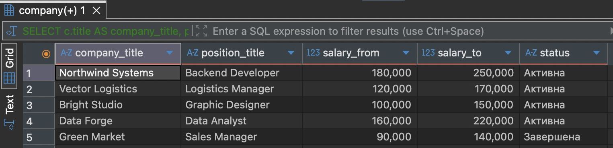

### 2.2.2 Внутреннее соединение для соискателей

**Вопрос:** Как получить список соискателей из задания 2.1.2 с помощью INNER JOIN?

**Ожидаемый результат:**

| ФИО | Пол | Образование | Желаемая должность |
| --- | --- | --- | --- |
| Alexey Smirnov | Мужской | Высшее | Backend Developer |
| Marina Belova | Женский | Высшее | Logistics Manager |
| Svetlana Ivanova | Женский | Высшее | Graphic Designer |
| Pavel Kuznetsov | Мужской | Высшее | Data Analyst |
| Olga Fedorova | Женский | Среднее специальное | Sales Manager |

**SQL-запрос**

```sql
SELECT
     un.full_name,
     un.sex,
     un.education,
     p.title AS position_title
FROM headhunter.unemployed AS un
INNER JOIN headhunter.position AS p ON un.position_id=p.id;
```

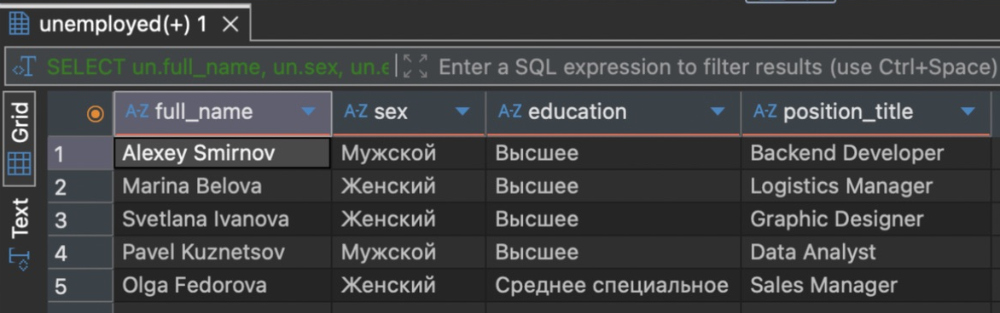

### 2.3.1 Левое соединение предприятий с активными вакансиями

**Вопрос:** Как с помощью LEFT JOIN вывести все предприятия и названия должностей их активных вакансий, сохранив в результате предприятия без активных вакансий?

**Ожидаемый результат:**

| Предприятие | Должность |
| --- | --- |
| Northwind Systems | Backend Developer |
| Vector Logistics | Logistics Manager |
| Bright Studio | Graphic Designer |
| Data Forge | Data Analyst |
| Green Market | `NULL` |

**SQL-запрос**

```sql
SELECT c.title, p.title
FROM headhunter.company AS c
LEFT JOIN headhunter.vacancy AS v ON c.id=v.company_id AND v.status='Активна'
LEFT JOIN headhunter.position AS p ON v.position_id=p.id;
```

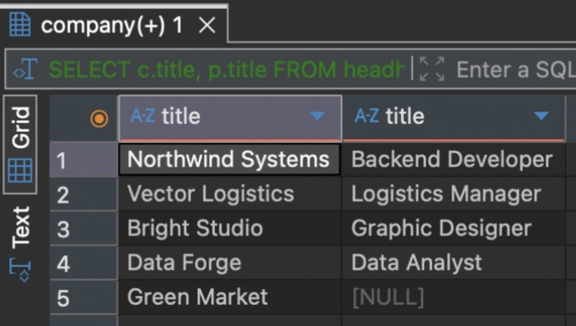

### 2.3.2 Левое соединение соискателей с действующими трудоустройствами

**Вопрос:** Как с помощью LEFT JOIN вывести всех соискателей и название предприятия, на котором каждый из них имеет действующее трудоустройство на контрольную дату, сохранив соискателей без действующего трудоустройства?

**Ожидаемый результат:**

| ФИО | Предприятие |
| --- | --- |
| Alexey Smirnov | `NULL` |
| Marina Belova | `NULL` |
| Svetlana Ivanova | `NULL` |
| Pavel Kuznetsov | `NULL` |
| Olga Fedorova | `NULL` |

Первое трудоустройство в исходных данных датировано 10 сентября 2026 года, после контрольной даты.

**SQL-запрос**

```sql
SELECT un.full_name, c.title
FROM headhunter.unemployed AS un
LEFT JOIN headhunter.employment AS em
    ON un.id = em.unemployed_id
   AND em.created_at <= (DATE '2026-09-01'::timestamp AT TIME ZONE 'Europe/Moscow')
   AND (em.dismissal_at IS NULL
        OR em.dismissal_at > (DATE '2026-09-01'::timestamp AT TIME ZONE 'Europe/Moscow'))
LEFT JOIN headhunter.vacancy AS v ON em.vacancy_id=v.id
LEFT JOIN headhunter.company AS c ON v.company_id=c.id;
```

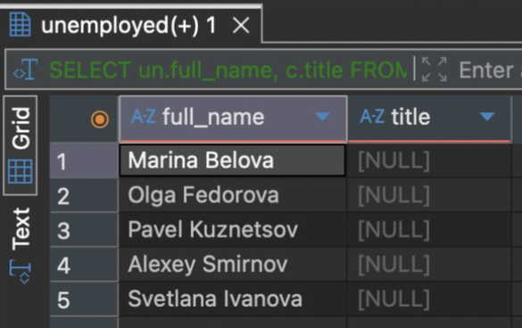

### 2.4.1 Правое соединение активных вакансий с должностями

**Вопрос:** Как с помощью RIGHT JOIN вывести все должности и предприятия с активными вакансиями на эти должности, сохранив должности без активных вакансий?

**Ожидаемый результат:**

| Должность | Предприятие |
| --- | --- |
| Backend Developer | Northwind Systems |
| Logistics Manager | Vector Logistics |
| Graphic Designer | Bright Studio |
| Data Analyst | Data Forge |
| Sales Manager | `NULL` |

**SQL-запрос**

```sql
SELECT p.title AS position_title, c.title AS company_title
FROM headhunter.vacancy AS v
INNER JOIN headhunter.company AS c ON v.company_id = c.id
RIGHT JOIN headhunter.position AS p ON v.position_id = p.id AND v.status='Активна';
```

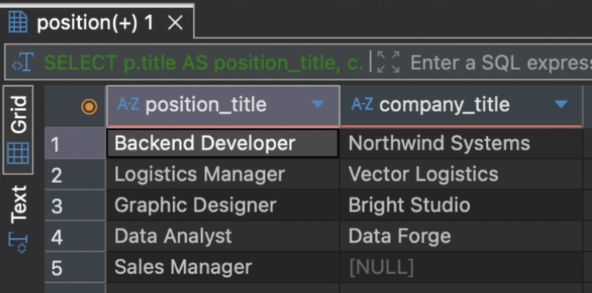

### 2.4.2 Правое соединение вакансий с предприятиями

**Вопрос:** Как с помощью `RIGHT JOIN` вывести все предприятия и нижние границы зарплат от 150 000 рублей? Для предприятия без подходящих вакансий вывести `NULL` в столбце зарплаты.

**Ожидаемый результат:**

| Предприятие | Зарплата от, ₽ |
| --- | ---: |
| Northwind Systems | 180 000 |
| Vector Logistics | `NULL` |
| Bright Studio | `NULL` |
| Data Forge | 160 000 |
| Green Market | `NULL` |

**SQL-запрос**

```sql
SELECT c.title, v.salary_from
FROM headhunter.vacancy AS v
RIGHT JOIN headhunter.company AS c ON v.company_id=c.id AND v.salary_from>=150000;
```

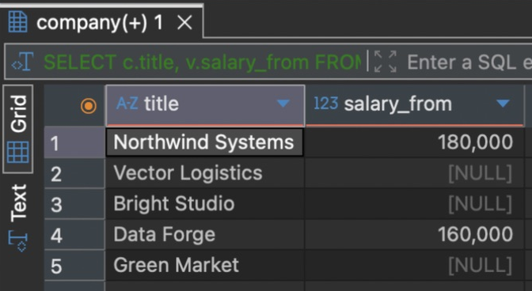

### 2.5.1 Средняя нижняя граница зарплаты по предприятию

**Вопрос:** Какова средняя нижняя граница зарплаты по вакансиям каждого предприятия? Включить предприятия без вакансий.

**Ожидаемый результат:**

| Предприятие | Средняя нижняя граница зарплаты, ₽ |
| --- | ---: |
| Northwind Systems | 180 000 |
| Vector Logistics | 120 000 |
| Bright Studio | 100 000 |
| Data Forge | 160 000 |
| Green Market | 90 000 |

**SQL-запрос**

```sql
SELECT c.title, AVG(v.salary_from) AS avg_min_salary
FROM headhunter.company AS c
LEFT JOIN headhunter.vacancy AS v ON v.company_id = c.id
GROUP BY c.id, c.title
ORDER BY c.id;
```

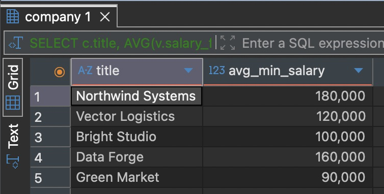

### 2.5.2 Число трудоустроенных по полу

**Вопрос:** Сколько мужчин и женщин трудоустроило агентство за всё время? Считать каждого соискателя один раз.

**Ожидаемый результат:**

| Пол | Трудоустроено соискателей |
| --- | ---: |
| Мужской | 2 |
| Женский | 3 |

**SQL-запрос**

```sql
SELECT u.sex, COUNT(DISTINCT u.id) AS hired_count
FROM headhunter.employment AS em
JOIN headhunter.unemployed AS u ON u.id = em.unemployed_id
GROUP BY u.sex
ORDER BY u.sex;
```

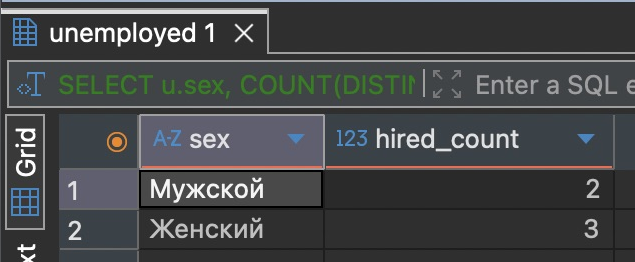

### 2.6.1 Отбор групп по средней зарплате

**Вопрос:** У каких предприятий средняя нижняя граница зарплаты по всем вакансиям превышает 130 000 рублей? Использовать группировку и HAVING.

**Ожидаемый результат:**

| Предприятие | Средняя нижняя граница зарплаты, ₽ |
| --- | ---: |
| Northwind Systems | 180 000 |
| Data Forge | 160 000 |

**SQL-запрос**

```sql
SELECT c.title, AVG(v.salary_from)
FROM headhunter.vacancy AS v
LEFT JOIN headhunter.company AS c ON c.id=v.company_id
GROUP BY c.id, c.title
HAVING AVG(v.salary_from) > 130000;
```

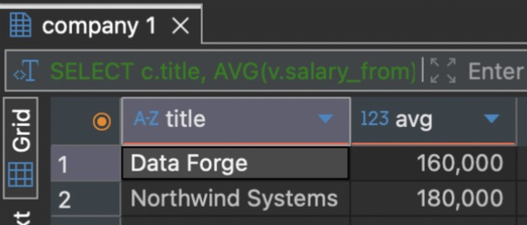

### 2.6.2 Отбор групп по количеству активных вакансий

**Вопрос:** Для каких должностей имеется хотя бы одна активная вакансия? Вывести название должности и количество активных вакансий, используя группировку и HAVING.

**Ожидаемый результат:**

| Должность | Активных вакансий |
| --- | ---: |
| Backend Developer | 1 |
| Logistics Manager | 1 |
| Graphic Designer | 1 |
| Data Analyst | 1 |

**SQL-запрос**

```sql
SELECT p.title, COUNT(v.id)
FROM headhunter.position AS p
LEFT JOIN headhunter.vacancy AS v ON p.id=v.position_id AND v.status='Активна'
GROUP BY p.id,p.title
HAVING COUNT(v.id) >= 1;
```

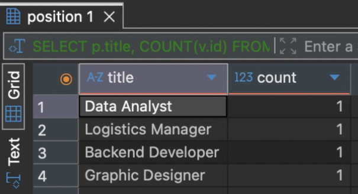

### 2.7.1 Вложенный запрос с IN

**Вопрос:** Какие соискатели указали желаемую должность, для которой существует активная вакансия? Использовать IN с вложенным запросом и вывести ФИО и желаемую должность.

**Ожидаемый результат:**

| ФИО | Желаемая должность |
| --- | --- |
| Alexey Smirnov | Backend Developer |
| Marina Belova | Logistics Manager |
| Svetlana Ivanova | Graphic Designer |
| Pavel Kuznetsov | Data Analyst |

**SQL-запрос**

```sql
SELECT un.full_name, p.title
FROM headhunter.unemployed AS un
INNER JOIN headhunter.position AS p ON un.position_id=p.id
WHERE un.position_id IN (
     SELECT v.position_id
     FROM headhunter.vacancy AS v
     WHERE v.status='Активна'
);
```

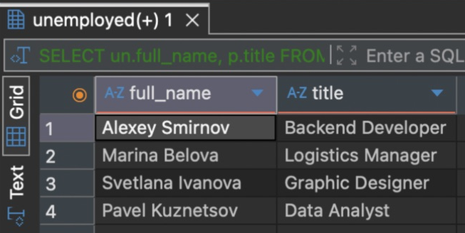

### 2.7.2 Соотнесенный запрос с EXISTS

**Вопрос:** Какие предприятия имеют хотя бы одну активную вакансию? Использовать соотнесенный подзапрос с EXISTS и вывести каждое предприятие один раз.

**Ожидаемый результат:**

| Предприятие |
| --- |
| Northwind Systems |
| Vector Logistics |
| Bright Studio |
| Data Forge |

**SQL-запрос**

```sql
SELECT c.title
FROM headhunter.company AS c
WHERE EXISTS (
     SELECT 1
     FROM headhunter.vacancy AS v
     WHERE v.status='Активна' AND c.id=v.company_id
);
```

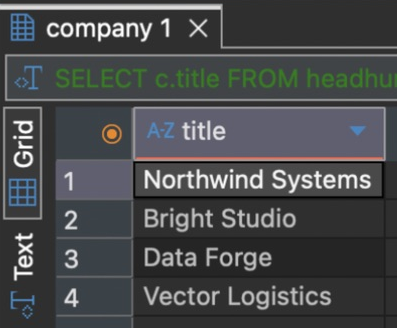

### 2.7.3 Соотнесенный запрос с NOT EXISTS

**Вопрос:** Какие соискатели не имеют ни одного действующего трудоустройства на контрольную дату? Использовать соотнесенный подзапрос с NOT EXISTS.

**Ожидаемый результат:**

| ФИО |
| --- |
| Alexey Smirnov |
| Marina Belova |
| Svetlana Ivanova |
| Pavel Kuznetsov |
| Olga Fedorova |

**SQL-запрос**

```sql
SELECT un.full_name
FROM headhunter.unemployed AS un
WHERE NOT EXISTS(
     SELECT 1
     FROM headhunter.employment AS em
     WHERE em.unemployed_id = un.id
     AND em.created_at <= (DATE '2026-09-01'::timestamp AT TIME ZONE 'Europe/Moscow')
     AND (
          em.dismissal_at IS NULL
          OR em.dismissal_at > (DATE '2026-09-01'::timestamp AT TIME ZONE 'Europe/Moscow')
     )
);
```

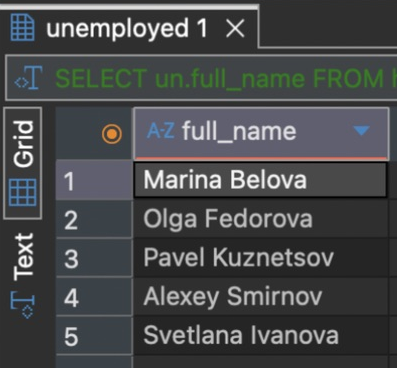

### 2.7.4 Вложенный запрос с агрегатной функцией

**Вопрос:** Какие вакансии имеют нижнюю границу зарплаты выше средней нижней границы по всем вакансиям? Среднее значение получить вложенным запросом; вывести предприятие, должность и нижнюю границу зарплаты.

**Ожидаемый результат:**

| Предприятие | Должность | Зарплата от, ₽ |
| --- | --- | ---: |
| Northwind Systems | Backend Developer | 180 000 |
| Data Forge | Data Analyst | 160 000 |

Средняя нижняя граница по всем вакансиям составляет 130 000 ₽.

**SQL-запрос**

```sql
SELECT
    c.title AS company_title,
    p.title AS position_title,
    v.salary_from
FROM headhunter.vacancy AS v
INNER JOIN headhunter.company AS c ON v.company_id = c.id
INNER JOIN headhunter.position AS p ON v.position_id = p.id
WHERE v.salary_from > (
    SELECT AVG(v_all.salary_from)
    FROM headhunter.vacancy AS v_all
);
```

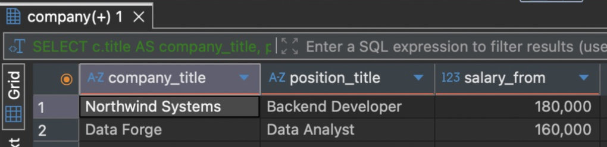

## 3 Представления и общетабличные выражения

### 3.1.1 Представление с подробной информацией о вакансиях

**Вопрос:** Как создать представление `headhunter.vw_vacancy_details` на основе задания 2.2.1 и получить из него список вакансий с названиями предприятий и должностей, границами зарплаты и статусом?

**Ожидаемый результат:**

| Предприятие | Должность | Зарплата от, ₽ | Зарплата до, ₽ | Статус |
| --- | --- | ---: | ---: | --- |
| Northwind Systems | Backend Developer | 180 000 | 250 000 | Активна |
| Vector Logistics | Logistics Manager | 120 000 | 170 000 | Активна |
| Bright Studio | Graphic Designer | 100 000 | 150 000 | Активна |
| Data Forge | Data Analyst | 160 000 | 220 000 | Активна |
| Green Market | Sales Manager | 90 000 | 140 000 | Завершена |

Таблица показывает результат чтения созданного представления.

**SQL-запрос**

```sql
CREATE VIEW headhunter.vw_vacancy_details AS
SELECT
    c.title AS company_title,
    p.title AS position_title,
    v.salary_from,
    v.salary_to,
    v.status
FROM headhunter.vacancy AS v
INNER JOIN headhunter.company AS c ON v.company_id = c.id
INNER JOIN headhunter.position AS p ON v.position_id = p.id;
```

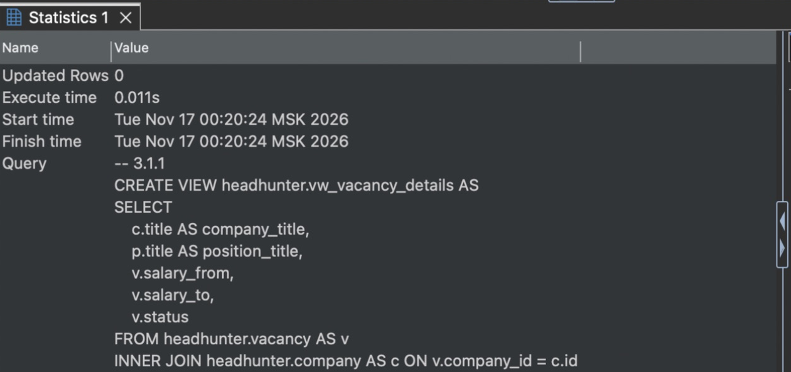

**Чтение представления**

```sql
SELECT * FROM headhunter.vw_vacancy_details;
```

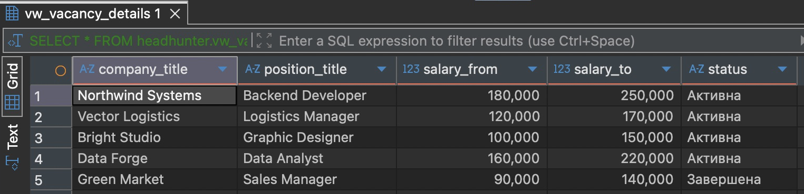

### 3.1.2 Представление со статистикой трудоустройств

**Вопрос:** Как создать представление `headhunter.vw_company_employment_stats` с числом разных трудоустроенных соискателей по каждому предприятию за всю историю?

**Ожидаемый результат:**

| Предприятие | Трудоустроено соискателей |
| --- | ---: |
| Northwind Systems | 1 |
| Vector Logistics | 1 |
| Bright Studio | 1 |
| Data Forge | 1 |
| Green Market | 1 |

Таблица показывает результат чтения созданного представления.

**SQL-запрос**

```sql
CREATE VIEW headhunter.vw_company_employment_stats AS
SELECT c.title AS company_title, COUNT(DISTINCT em.unemployed_id) AS count_em
FROM headhunter.company AS c
LEFT JOIN headhunter.vacancy AS v ON v.company_id = c.id
LEFT JOIN headhunter.employment AS em ON em.vacancy_id = v.id
GROUP BY c.id, c.title;
```

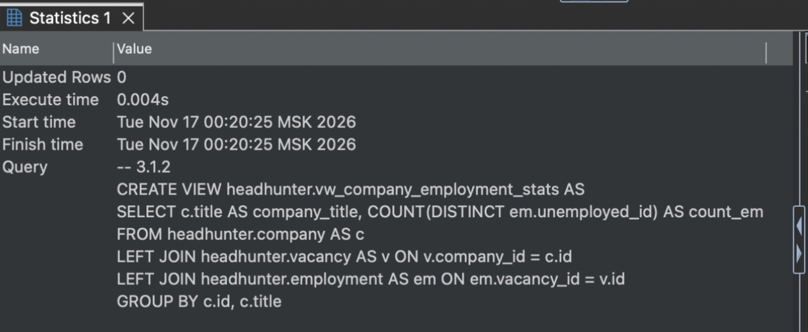

**Чтение представления**

```sql
SELECT * FROM headhunter.vw_company_employment_stats;
```

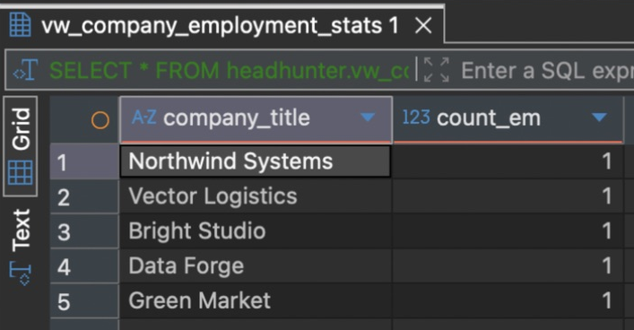

### 3.2.1 CTE для расчета возраста

**Вопрос:** Как с помощью CTE рассчитать возраст каждого соискателя в полных годах на контрольную дату и вывести только тех, кто младше 32 лет?

**Ожидаемый результат:**

| ФИО | Возраст, лет |
| --- | ---: |
| Alexey Smirnov | 31 |
| Svetlana Ivanova | 28 |
| Pavel Kuznetsov | 31 |
| Olga Fedorova | 30 |

**SQL-запрос**

```sql
WITH unemployed_age AS (
    SELECT un.full_name, EXTRACT(YEAR FROM AGE(DATE '2026-09-01', un.birth_date)) AS age
    FROM headhunter.unemployed AS un
)
SELECT full_name, age
FROM unemployed_age
WHERE age < 32;
```

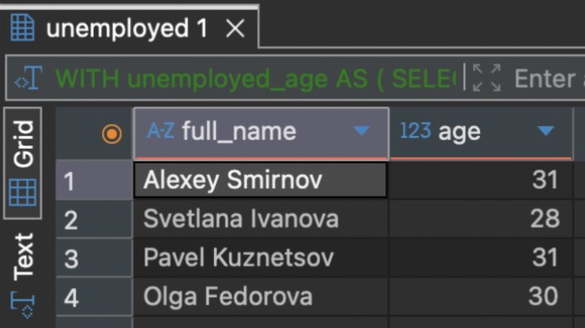

### 3.2.2 CTE для поиска предприятий без активных вакансий

**Вопрос:** Как с помощью CTE рассчитать количество активных вакансий каждого предприятия, а затем вывести предприятия, для которых это количество равно нулю?

**Ожидаемый результат:**

| Предприятие | Активных вакансий |
| --- | ---: |
| Green Market | 0 |

**SQL-запрос**

```sql
WITH vacancy_company AS (
    SELECT c.title AS company_title, COUNT(v.id) AS count_v
    FROM headhunter.company AS c
    LEFT JOIN headhunter.vacancy AS v ON c.id = v.company_id AND v.status = 'Активна'
    GROUP BY c.id, c.title
)
SELECT company_title, count_v
FROM vacancy_company
WHERE count_v = 0;
```

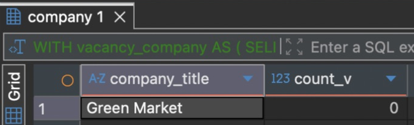

## 4 Функции ранжирования

### 4.1.1 ROW_NUMBER без разбиения

**Вопрос:** Как пронумеровать все вакансии с помощью ROW_NUMBER в порядке убывания нижней границы зарплаты, при одинаковой зарплате упорядочивая их по идентификатору вакансии по возрастанию?

**Ожидаемый результат:**

| Номер | Предприятие | Должность | Зарплата от, ₽ |
| ---: | --- | --- | ---: |
| 1 | Northwind Systems | Backend Developer | 180 000 |
| 2 | Data Forge | Data Analyst | 160 000 |
| 3 | Vector Logistics | Logistics Manager | 120 000 |
| 4 | Bright Studio | Graphic Designer | 100 000 |
| 5 | Green Market | Sales Manager | 90 000 |

**SQL-запрос**

```sql
SELECT
     ROW_NUMBER() OVER (
          ORDER BY v.salary_from DESC, v.id ASC
     ) AS row_num,
     c.title AS company_title,
     p.title AS position_title,
     v.salary_from
FROM headhunter.vacancy AS v
JOIN headhunter.position AS p ON v.position_id=p.id
JOIN headhunter.company AS c ON v.company_id=c.id
ORDER BY row_num;
```

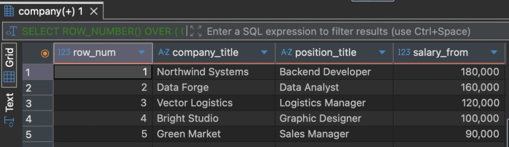

### 4.1.2 ROW_NUMBER с PARTITION BY

**Вопрос:** Как отдельно пронумеровать вакансии внутри каждого уровня требуемого образования, используя ROW_NUMBER с PARTITION BY и упорядочивая вакансии по убыванию нижней границы зарплаты, затем по идентификатору по возрастанию?

**Ожидаемый результат:**

| Требуемое образование | Номер | Должность | Зарплата от, ₽ |
| --- | ---: | --- | ---: |
| Среднее специальное | 1 | Sales Manager | 90 000 |
| Высшее | 1 | Backend Developer | 180 000 |
| Высшее | 2 | Data Analyst | 160 000 |
| Высшее | 3 | Logistics Manager | 120 000 |
| Высшее | 4 | Graphic Designer | 100 000 |

**SQL-запрос**

```sql
SELECT
     v.education_min,
     ROW_NUMBER() OVER (
          PARTITION BY v.education_min
          ORDER BY v.salary_from DESC, v.id ASC
     ) AS row_num,
     p.title AS position_title,
     v.salary_from
FROM headhunter.vacancy AS v
JOIN headhunter.position AS p ON v.position_id=p.id
ORDER BY v.education_min, row_num;
```

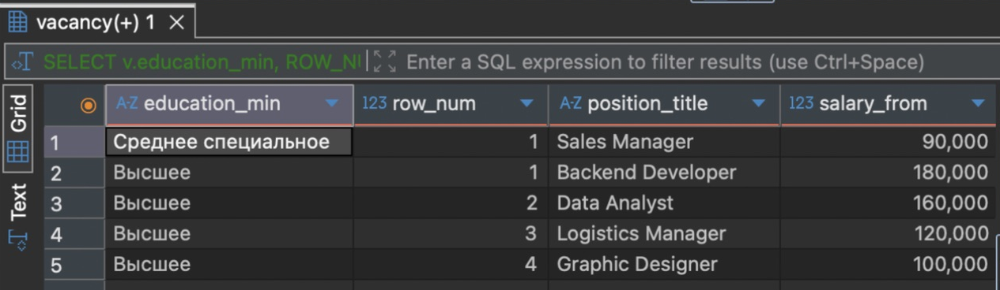

### 4.1.3 RANK для востребованности должностей

**Вопрос:** Как присвоить всем должностям места по убыванию количества активных вакансий с помощью RANK, включая должности без активных вакансий? Одинаковым количествам присвоить одинаковое место с пропусками после совпадений.

**Ожидаемый результат:**

| Должность | Активных вакансий | Место |
| --- | ---: | ---: |
| Backend Developer | 1 | 1 |
| Data Analyst | 1 | 1 |
| Graphic Designer | 1 | 1 |
| Logistics Manager | 1 | 1 |
| Sales Manager | 0 | 5 |

**SQL-запрос**

```sql
SELECT
    p.title AS position_title,
    COUNT(v.id) AS active_vacancy_count,
    RANK() OVER (
        ORDER BY COUNT(v.id) DESC
    ) AS rank_num
FROM headhunter.vacancy AS v
RIGHT JOIN headhunter.position AS p
    ON v.position_id = p.id
   AND v.status = 'Активна'
GROUP BY p.id, p.title
ORDER BY rank_num, position_title;
```

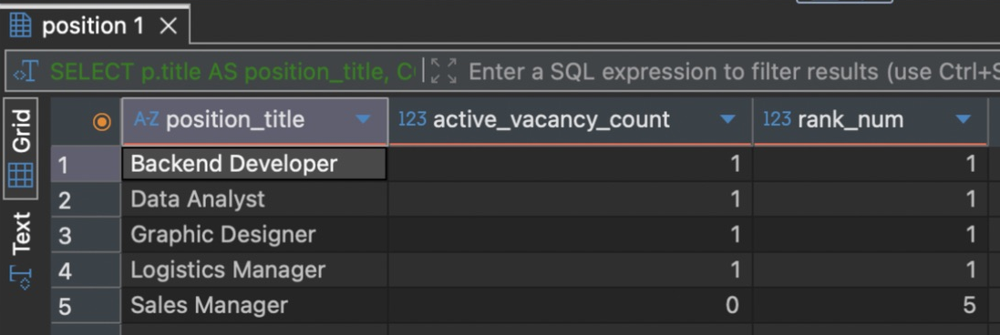

### 4.1.4 DENSE_RANK для востребованности должностей

**Вопрос:** Как присвоить должностям места по тому же показателю, что в задании 4.1.3, с помощью DENSE_RANK, чтобы после одинаковых мест не было пропусков?

**Ожидаемый результат:**

| Должность | Активных вакансий | Место |
| --- | ---: | ---: |
| Backend Developer | 1 | 1 |
| Data Analyst | 1 | 1 |
| Graphic Designer | 1 | 1 |
| Logistics Manager | 1 | 1 |
| Sales Manager | 0 | 2 |

**SQL-запрос**

```sql
SELECT
    p.title AS position_title,
    COUNT(v.id) AS active_vacancy_count,
    DENSE_RANK() OVER (
        ORDER BY COUNT(v.id) DESC
    ) AS dense_rank_num
FROM headhunter.position AS p
LEFT JOIN headhunter.vacancy AS v
    ON v.position_id = p.id
   AND v.status = 'Активна'
GROUP BY p.id, p.title
ORDER BY dense_rank_num, position_title;
```

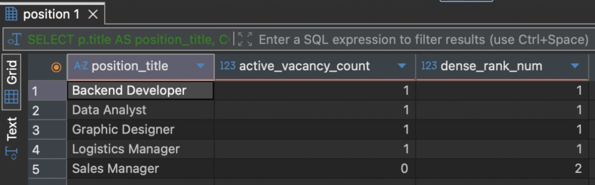

## 5 Объединение пересечение и разность

### 5.1.1 UNION с сортировкой

**Вопрос:** Как объединить без повторений названия предприятий, у которых есть вакансия с нижней границей зарплаты не менее 120 000 рублей, и названия предприятий, у которых есть вакансия с требованием высшего образования? Использовать UNION и отсортировать результат по названию по возрастанию.

**Ожидаемый результат:**

| Предприятие |
| --- |
| Bright Studio |
| Data Forge |
| Northwind Systems |
| Vector Logistics |

**SQL-запрос**

```sql
SELECT c.title AS company_title
FROM headhunter.vacancy AS v
JOIN headhunter.company AS c ON v.company_id=c.id
WHERE v.salary_from >=120000

UNION

SELECT c.title
FROM headhunter.company AS c
JOIN headhunter.vacancy AS v ON v.company_id = c.id
WHERE v.education_min = 'Высшее'

ORDER BY company_title;
```

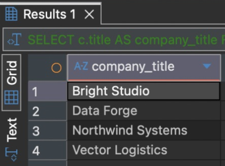

### 5.1.2 UNION ALL с сохранением повторений

**Вопрос:** Как объединить те же две выборки, что в задании 5.1.1, с помощью UNION ALL, сохранив повторения?

**Ожидаемый результат:**

| Предприятие |
| --- |
| Bright Studio |
| Data Forge |
| Data Forge |
| Northwind Systems |
| Northwind Systems |
| Vector Logistics |
| Vector Logistics |

**SQL-запрос**

```sql
SELECT c.title AS company_title
FROM headhunter.vacancy AS v
JOIN headhunter.company AS c ON v.company_id=c.id
WHERE v.salary_from >=120000

UNION ALL

SELECT c.title
FROM headhunter.company AS c
JOIN headhunter.vacancy AS v ON v.company_id = c.id
WHERE v.education_min = 'Высшее'

ORDER BY company_title;
```

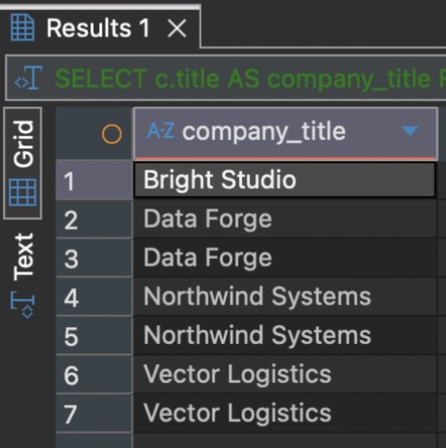

### 5.1.3 EXCEPT для разности множеств

**Вопрос:** Как с помощью EXCEPT найти соискателей из общего реестра, которых нет среди лиц с действующим трудоустройством на контрольную дату? Сравнивать по идентификатору соискателя, а в результате вывести идентификатор и ФИО.

**Ожидаемый результат:**

| ID соискателя | ФИО |
| ---: | --- |
| 1 | Alexey Smirnov |
| 2 | Marina Belova |
| 3 | Svetlana Ivanova |
| 4 | Pavel Kuznetsov |
| 5 | Olga Fedorova |

**SQL-запрос**

```sql
WITH without_employment AS (
    SELECT id
    FROM headhunter.unemployed

    EXCEPT

    SELECT unemployed_id
    FROM headhunter.employment
    WHERE created_at <= (DATE '2026-09-01'::timestamp AT TIME ZONE 'Europe/Moscow')
      AND (dismissal_at IS NULL
           OR dismissal_at > (DATE '2026-09-01'::timestamp AT TIME ZONE 'Europe/Moscow'))
)
SELECT un.id, un.full_name
FROM without_employment AS we
JOIN headhunter.unemployed AS un ON un.id = we.id;
```

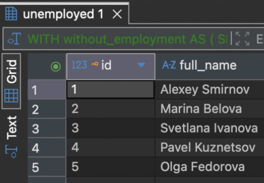

### 5.1.4 INTERSECT для пересечения множеств

**Вопрос:** Какие должности одновременно указаны как желаемые соискателями с высшим образованием и представлены среди активных вакансий? Использовать INTERSECT по идентификаторам должностей и вывести их названия.

**Ожидаемый результат:**

| Должность |
| --- |
| Backend Developer |
| Logistics Manager |
| Graphic Designer |
| Data Analyst |

**SQL-запрос**

```sql
WITH matching_positions AS (
    SELECT position_id
    FROM headhunter.unemployed
    WHERE education = 'Высшее'

    INTERSECT

    SELECT position_id
    FROM headhunter.vacancy
    WHERE status = 'Активна'
)
SELECT p.title AS position_title
FROM matching_positions AS mp
JOIN headhunter.position AS p ON p.id = mp.position_id;
```

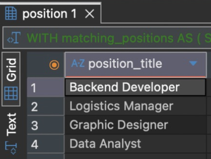

## 6 Сводные таблицы

### 6.1.1 Сводная таблица образования и пола с CASE

**Вопрос:** Как с помощью CASE и агрегатных функций построить сводную таблицу количества соискателей по образованию с отдельными столбцами «М», «Ж» и «Всего»? Выводить только уровни образования, которые есть в реестре.

**Ожидаемый результат:**

| Образование | М | Ж | Всего |
| --- | ---: | ---: | ---: |
| Высшее | 2 | 2 | 4 |
| Среднее специальное | 0 | 1 | 1 |

**SQL-запрос**

```sql
SELECT
     education,
     COUNT(CASE WHEN sex='Мужской' THEN 1 END) AS "М",
     COUNT(CASE WHEN sex='Женский' THEN 1 END) AS "Ж",
     COUNT(*) AS "Всего"
FROM headhunter.unemployed AS um
GROUP BY education;
```

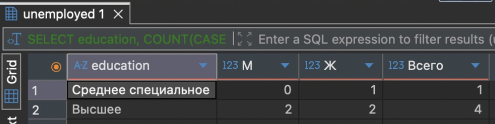

### 6.1.2 Сводная таблица статусов вакансий с CASE

**Вопрос:** Как с помощью CASE и агрегатных функций вывести все предприятия, а для каждого — отдельные столбцы с количеством активных и завершенных вакансий?

**Ожидаемый результат:**

| Предприятие | Активна | Завершена |
| --- | ---: | ---: |
| Northwind Systems | 1 | 0 |
| Vector Logistics | 1 | 0 |
| Bright Studio | 1 | 0 |
| Data Forge | 1 | 0 |
| Green Market | 0 | 1 |

**SQL-запрос**

```sql
SELECT
    c.title AS company_title,
    COUNT(CASE WHEN v.status = 'Активна' THEN 1 END) AS "Активна",
    COUNT(CASE WHEN v.status = 'Завершена' THEN 1 END) AS "Завершена"
FROM headhunter.company AS c
LEFT JOIN headhunter.vacancy AS v ON v.company_id = c.id
GROUP BY c.id, c.title;
```

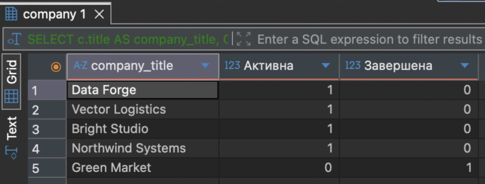

### 6.2.1 Сводная таблица с PIVOT

**Вопрос:** Как получить сводную таблицу из задания 6.1.2 с помощью PIVOT, преобразовав значения статуса вакансии в отдельные столбцы «Активна» и «Завершена»?

**Ожидаемый результат:**

| Предприятие | Активна | Завершена |
| --- | ---: | ---: |
| Northwind Systems | 1 | 0 |
| Vector Logistics | 1 | 0 |
| Bright Studio | 1 | 0 |
| Data Forge | 1 | 0 |
| Green Market | 0 | 1 |

**SQL-запрос**

```sql
WITH vacancy_summary AS (
    SELECT
        c.title AS company_title,
        COUNT(v.id) FILTER (WHERE v.status = 'Активна') AS active_count,
        COUNT(v.id) FILTER (WHERE v.status = 'Завершена') AS completed_count
    FROM headhunter.company AS c
    LEFT JOIN headhunter.vacancy AS v ON v.company_id = c.id
    GROUP BY c.id, c.title
)
SELECT
    company_title,
    active_count AS "Активна",
    completed_count AS "Завершена"
FROM vacancy_summary;
```

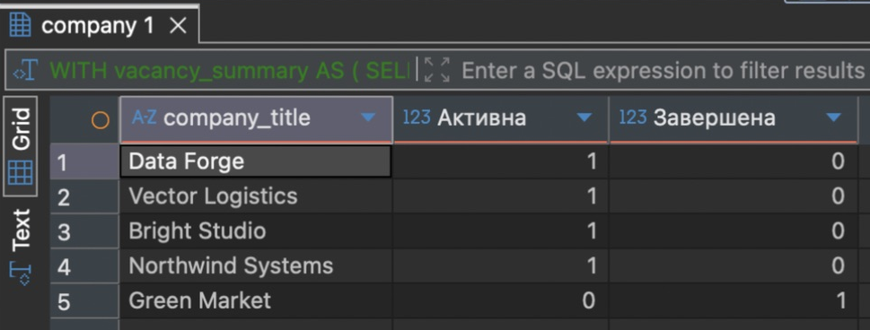

### 6.2.2 Преобразование сводной таблицы с UNPIVOT

**Вопрос:** Как с помощью UNPIVOT преобразовать сводную таблицу из задания 6.2.1 в таблицу со столбцами «Предприятие», «Статус», «Количество вакансий», сохранив строки с нулевым количеством?

**Ожидаемый результат:**

| Предприятие | Статус | Вакансий |
| --- | --- | ---: |
| Northwind Systems | Активна | 1 |
| Northwind Systems | Завершена | 0 |
| Vector Logistics | Активна | 1 |
| Vector Logistics | Завершена | 0 |
| Bright Studio | Активна | 1 |
| Bright Studio | Завершена | 0 |
| Data Forge | Активна | 1 |
| Data Forge | Завершена | 0 |
| Green Market | Активна | 0 |
| Green Market | Завершена | 1 |

**SQL-запрос**

```sql
WITH vacancy_summary AS (
    SELECT
        c.title AS company_title,
        COUNT(v.id) FILTER (WHERE v.status = 'Активна') AS active_count,
        COUNT(v.id) FILTER (WHERE v.status = 'Завершена') AS completed_count
    FROM headhunter.company AS c
    LEFT JOIN headhunter.vacancy AS v ON v.company_id = c.id
    GROUP BY c.id, c.title
)
SELECT
    vs.company_title,
    s.status,
    s.vacancy_count
FROM vacancy_summary AS vs
CROSS JOIN LATERAL (
    VALUES
        ('Активна', vs.active_count),
        ('Завершена', vs.completed_count)
) AS s(status, vacancy_count);
```

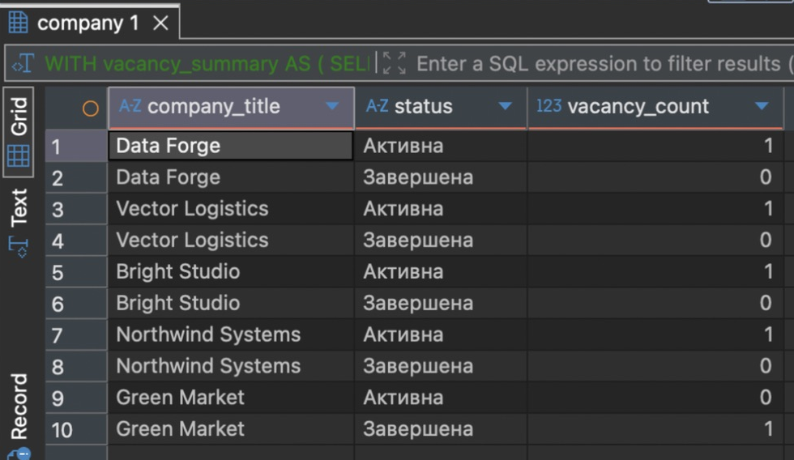

## Часть 2

### a Подбор вакансий для Alexey Smirnov

**Вопрос:** Какие активные вакансии подходят Alexey Smirnov по полу, возрасту и образованию? Вывести должность и нижнюю границу зарплаты. Возраст считать на 1 сентября 2026 года.

**Ожидаемый результат:**

| Должность | Зарплата от, ₽ |
| --- | ---: |
| Backend Developer | 180 000 |
| Data Analyst | 160 000 |
| Graphic Designer | 100 000 |
| Logistics Manager | 120 000 |

**SQL-запрос**

```sql
SELECT p.title AS position_title, v.salary_from
FROM headhunter.vacancy AS v
JOIN headhunter.position AS p ON p.id = v.position_id
CROSS JOIN headhunter.unemployed AS u
WHERE u.full_name = 'Alexey Smirnov'
  AND v.status = 'Активна'
  AND (v.sex = 'Не важен' OR v.sex = u.sex)
  AND EXTRACT(YEAR FROM AGE(DATE '2026-09-01', u.birth_date)) BETWEEN v.age_from AND v.age_to
  AND u.education >= v.education_min
ORDER BY p.title;
```

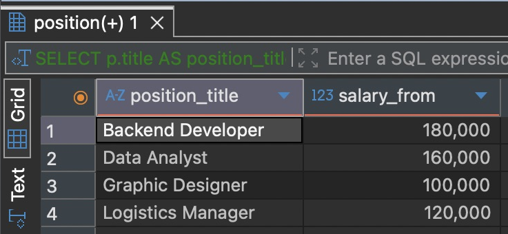

### b Должности по числу активных вакансий

**Вопрос:** Сколько активных вакансий есть по каждой должности? Вывести все должности по убыванию количества, включая должности без активных вакансий.

**Ожидаемый результат:**

| Должность | Активных вакансий |
| --- | ---: |
| Backend Developer | 1 |
| Data Analyst | 1 |
| Graphic Designer | 1 |
| Logistics Manager | 1 |
| Sales Manager | 0 |

**SQL-запрос**

```sql
SELECT p.title, COUNT(v.id) AS active_count
FROM headhunter.position AS p
LEFT JOIN headhunter.vacancy AS v ON v.position_id = p.id AND v.status = 'Активна'
GROUP BY p.id, p.title
ORDER BY active_count DESC, p.title;
```

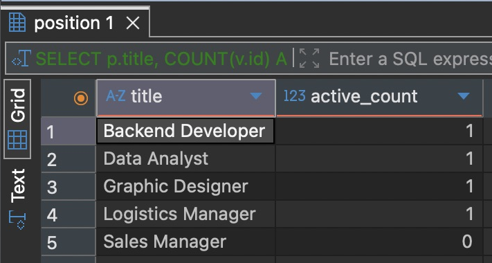

### c Предприятия с ограничениями по возрасту и полу

**Вопрос:** Какие предприятия задают хотя бы одно ограничение по возрасту или полу в своих вакансиях? Вывести предприятие, должность, возрастной интервал, требуемый пол и отдельные признаки наличия ограничения по возрасту и по полу. Возрастным ограничением в этом задании считать заданный конечный интервал допустимого возраста, ограничением по полу — значение, отличное от «Не важен».

**Ожидаемый результат:**

| Предприятие | Должность | Возраст, лет | Требуемый пол | Ограничение по возрасту | Ограничение по полу |
| --- | --- | --- | --- | --- | --- |
| Northwind Systems | Backend Developer | 22–45 | Не важен | Да | Нет |
| Vector Logistics | Logistics Manager | 25–50 | Не важен | Да | Нет |
| Bright Studio | Graphic Designer | 21–40 | Не важен | Да | Нет |
| Data Forge | Data Analyst | 23–45 | Не важен | Да | Нет |
| Green Market | Sales Manager | 20–45 | Не важен | Да | Нет |

**SQL-запрос**

```sql
WITH vacancy_limits AS (
    SELECT v.*,
           v.age_from IS NOT NULL AND v.age_to IS NOT NULL AS age_restricted,
           v.sex <> 'Не важен' AS sex_restricted
    FROM headhunter.vacancy AS v
)
SELECT c.title AS company_title,
       p.title AS position_title,
       CONCAT(v.age_from, '–', v.age_to) AS age_range,
       v.sex,
       CASE WHEN v.age_restricted THEN 'Да' ELSE 'Нет' END AS age_restricted,
       CASE WHEN v.sex_restricted THEN 'Да' ELSE 'Нет' END AS sex_restricted
FROM vacancy_limits AS v
JOIN headhunter.company AS c ON c.id = v.company_id
JOIN headhunter.position AS p ON p.id = v.position_id
WHERE v.age_restricted OR v.sex_restricted
ORDER BY c.id, v.id;
```

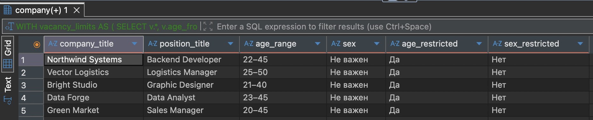

### d Соискатели младше 25 лет с высшим образованием

**Вопрос:** Сколько соискателей в реестре `unemployed` на контрольную дату младше 25 лет и имеют высшее образование?

**Ожидаемый результат:**

| Соискателей младше 25 лет с высшим образованием |
| ---: |
| 0 |

**SQL-запрос**

```sql
SELECT COUNT(*) AS applicant_count
FROM headhunter.unemployed AS u
WHERE u.education = 'Высшее'
  AND EXTRACT(YEAR FROM AGE(DATE '2026-09-01', u.birth_date)) BETWEEN 0 AND 24
  AND u.birth_date <= DATE '2026-09-01';
```

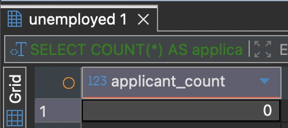

### e Отчёт о трудоустройствах по предприятиям

**Вопрос:** Сколько трудоустройств было у каждого предприятия? Вывести общее количество и разбивку по полу, образованию и возрасту. Возраст считать на 1 сентября 2026 года. Учитывать все записи о трудоустройстве, включая те, по которым сотрудник уже уволился.

**Ожидаемый результат:**

| Предприятие | Трудоустройств | М | Ж | Высшее обр. | Среднее спец. | До 40 лет | 40 лет и старше |
| --- | ---: | ---: | ---: | ---: | ---: | ---: | ---: |
| Northwind Systems | 1 | 1 | 0 | 1 | 0 | 1 | 0 |
| Vector Logistics | 1 | 0 | 1 | 1 | 0 | 1 | 0 |
| Bright Studio | 1 | 0 | 1 | 1 | 0 | 1 | 0 |
| Data Forge | 1 | 1 | 0 | 1 | 0 | 1 | 0 |
| Green Market | 1 | 0 | 1 | 0 | 1 | 1 | 0 |

**SQL-запрос**

```sql
SELECT c.title AS "Предприятие",
       COUNT(em.id) AS "Трудоустройств",
       COUNT(*) FILTER (WHERE u.sex = 'Мужской') AS "М",
       COUNT(*) FILTER (WHERE u.sex = 'Женский') AS "Ж",
       COUNT(*) FILTER (WHERE u.education = 'Высшее') AS "Высшее обр.",
       COUNT(*) FILTER (WHERE u.education = 'Среднее специальное') AS "Среднее спец.",
       COUNT(*) FILTER (WHERE u.birth_date > DATE '2026-09-01' - INTERVAL '40 years') AS "До 40 лет",
       COUNT(*) FILTER (WHERE u.birth_date <= DATE '2026-09-01' - INTERVAL '40 years') AS "40 лет и старше"
FROM headhunter.company AS c
LEFT JOIN headhunter.vacancy AS v ON v.company_id = c.id
LEFT JOIN headhunter.employment AS em ON em.vacancy_id = v.id
LEFT JOIN headhunter.unemployed AS u ON u.id = em.unemployed_id
GROUP BY c.id, c.title
ORDER BY c.id;
```

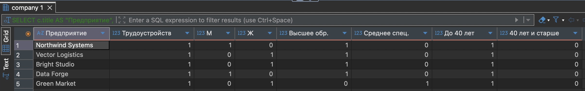
